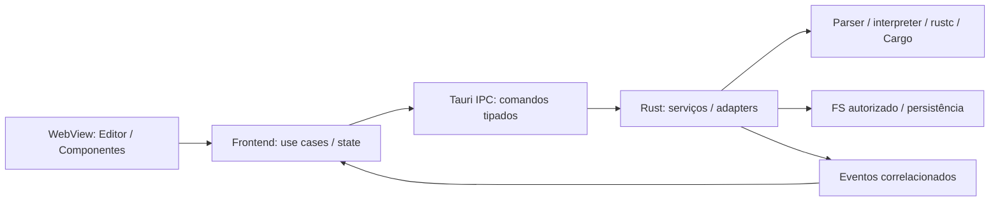

# Contrato de integração Rust + Tauri — PROPOSTA

**Descobrir versão exata de Tauri e convenções do projeto antes de implementar.** Assinaturas abaixo são exemplos conceituais, não substitutos para API da versão instalada. Manter compatibilidade com IPC já publicado.

## Fronteira de confiança



- WebView é **não confiável para autorização**. Validar entradas e caminhos no backend Rust, mesmo quando UI bloqueia ações.
- Operações FS limitadas ao workspace explicitamente escolhido, com proteção contra path traversal/symlinks fora do escopo, controles para leitura/gravação e confirmação de operações destrutivas.
- Execução de código do aluno é não confiável: processo isolado quando possível, timeout, cancelamento, limites de recursos, diretório temporário segregado, tratamento de stdout/stderr, sem segredos e com cleanup.
- Para casos em que não há sandbox forte na plataforma, divulgar claramente o risco de execução local e não prometer isolamento que não existe.
- Tauri v2: avaliar capabilities e permissões efetivamente utilizadas; v1: avaliar allowlist e escopos adequados. Nunca ampliar permissões globalmente só para fazer um botão funcionar.
- Não usar permissões de shell amplas ou aceitar comandos arbitrários do frontend; Rust seleciona executável/argumentos com allowlist e validação.

## Modelo de mensagens (sem amarrar à framework)

Commands sugeridos *somente se não houver equivalentes atuais*: `workspace_open`, `file_read`, `file_save`, `source_analyze`, `source_translate`, `run_start`, `run_cancel`, `debug_command`, `capabilities_get`.

Envelopes conceituais:

```json
{
  "requestId": "uuid",
  "workspaceId": "w-id",
  "documentId": "file-id",
  "revision": 12,
  "operation": "run_start",
  "payload": {"engine": "portugol", "timeoutMs": 3000}
}
```

```json
{
  "requestId": "uuid",
  "sequence": 4,
  "kind": "stdout",
  "payload": {"text": "17\n"}
}
```

- `requestId` identifica a solicitação; `sequence` é crescente por execução. Eventos tardios de solicitações anteriores não alteram sessão nova.
- `revision` identifica o snapshot editado; `documentId` é identidade estável, não caminho mutável.
- Os nomes IPC sugeridos **não são API obrigatória**: mapear para comandos existentes e documentar adaptadores.
- Erros tipados: `INVALID_INPUT`, `OUTSIDE_WORKSPACE`, `NOT_FOUND`, `STALE_REVISION`, `CAPABILITY_UNAVAILABLE`, `TOOLCHAIN_MISSING`, `TIMEOUT`, `CANCELLED`, `INTERNAL`; preservar detalhes técnicos em logs, apresentar mensagens seguras na interface.

## Modelo Rust ilustrativo (adaptar aos crates atuais)

```rust
#[derive(serde::Serialize, serde::Deserialize)]
#[serde(rename_all = "camelCase")]
pub struct RequestContext {
    pub request_id: String,
    pub workspace_id: String,
    pub document_id: String,
    pub revision: u64,
}

#[derive(serde::Serialize, serde::Deserialize)]
#[serde(tag = "kind", content = "payload", rename_all = "snake_case")]
pub enum ExecutionEvent {
    Started,
    Stdout { text: String },
    Stderr { text: String },
    Exited { code: i32 },
    Cancelled,
}
```

**Não copiar mecanicamente**: usar nomeação/serialização e mecanismos de eventos vigentes. `Exited` pode requerer código opcional em cenários de sinal; registrar corretamente.

## Fluxos IPC a validar

1. Frontend obtém capabilities efetivas, não as presume.
2. Evento `run_start`: backend valida escopo, captura snapshot, cria tarefa e devolve ID correlacionável.
3. Backend emite started/stdout/stderr/exited/cancelled; frontend normaliza por requestId e ordem.
4. Desmontagem UI/fechamento de janela cancela listeners e evita leaks; tarefas devem ser encerradas ou explicitamente gerenciadas.
5. `run_cancel` retorna aceite do cancelamento; UI só exibe cancelado após confirmação efetiva.
6. Tradução/diagnóstico associados a revisão; respostas antigas são descartadas.

## Testes obrigatórios da fronteira

- Invoke payload inválido → erro tipado, não panic.
- Path traversal e symlink escapando workspace → rejeição.
- Corrida de revisões, respostas fora de ordem e duplicidade de eventos.
- Processo demorado → timeout/cancelamento e limpeza de subprocessos.
- Falta de `cargo`/`rustc` → capacidade ausente e erro instrutivo.
- Permissões insuficientes → erro sem ampliar escopo.
- Fechar janela durante execução → sem processo órfão / sem vazamento de listeners.
