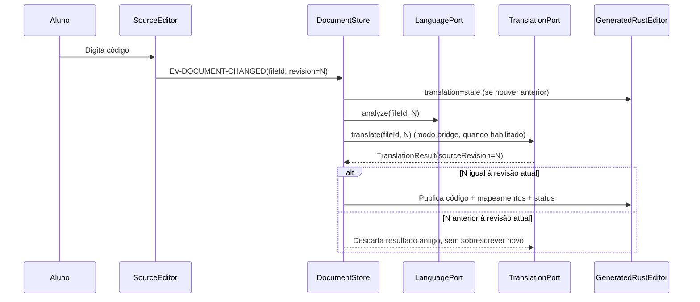
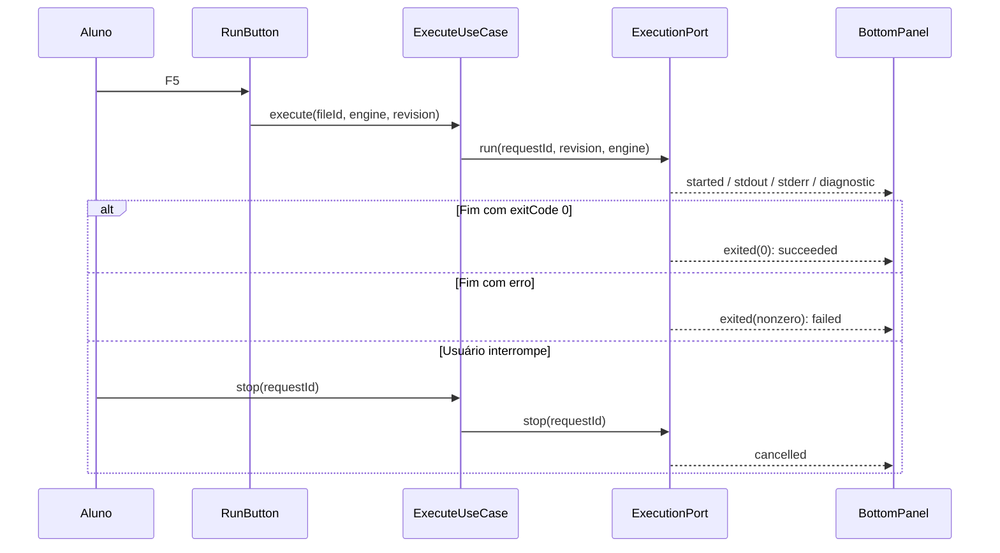

# Ferro Studio Next — UI ↔ Funcionalidade ↔ Testes

> Versão 0.2.0 · Status: especificação proposta · Idioma: pt-BR · Complementa `DESIGN_AS_CODE.md` v0.1.0
> Público: agentes de implementação, engenharia, QA, design, docentes.

## 0. Regra central

**Nenhum controle pode ser apenas decorativo.** Todo controle acionável deve estar ligado a um caso de uso, comando, estado observável, tratamento de erro e teste. Uma operação só pode exibir sucesso após confirmação do serviço responsável. A imagem de referência é um conceito visual, **não comprovação de que uma feature existe**.

Este documento não presume framework, bibliotecas, formatos legados ou capacidades existentes. O agente deve primeiro inspecionar o repositório. Quando a engine não oferecer uma capacidade: (a) desabilitar o controle e explicar por quê; ou (b) oferecer explicitamente modo demonstrativo rotulado. **Nunca falsificar stdout, tempos, compilações, diagnósticos ou resultados de testes.**

### Glossário de camadas

- `UI`: componentes e acessibilidade; não interpreta código.
- `Application`: casos de uso, orquestração, sessão, persistência de layout.
- `Domain`: arquivos, diagnósticos, mapeamentos, lições, execução e estados.
- `Adapter`: conexão com editor, filesystem, parser, tradutor, runtime, rustc/Cargo, debugger e storage.
- `Infrastructure`: IPC, processos, sandbox, file watchers, logs e sistema operacional.

## 1. Inventário visual e contratos rastreáveis

**Identificadores:** `UI-*` = elemento, `UC-*` = caso de uso, `EV-*` = evento, `AC-*` = critério, `FT-*` = teste de feature. Para automação, o `data-testid` / identificador equivalente deve ser estável; rótulos visíveis são traduzíveis.

| UI ID / componente | Área e identificador de teste | Funcionalidade / UC | Entrada → efeito verificável | Dependência | Testes |
|---|---|---|---|---|---|
| UI-001 `AppShell` | raiz `ide-shell` | UC-01 abrir workspace | workspace → layout e estado restaurado | WorkspaceStore, LayoutStore | FT-01, FT-09 |
| UI-002 `TitleBar/WorkspaceSelector` | topo `workspace-selector` | UC-01 trocar projeto | clique/seleção → troca com guarda de arquivos não salvos | WorkspaceService | FT-01, FT-08 |
| UI-003 `RunButton` | topo `run-button` | UC-06 executar | clique/F5 → request com engine e revisão capturada | ExecutionService | FT-03 |
| UI-004 `RuntimeSelector` | topo `runtime-selector` | UC-06 escolher motor | selecionar `ferro`/`rust` → engine persistido/validado | CapabilityService | FT-03, FT-06 |
| UI-005 `DebugButton` | topo `debug-button` | UC-09 iniciar debug | clique → sessão real ou controle indisponível | DebugService | FT-07 |
| UI-006 `ShareButton` | topo `share-button` | UC-14 compartilhar/exportar | clique → exportação local, ou compartilhamento somente com integração habilitada | ExportService | FT-10 |
| UI-007 `ActivityRail` | esquerda `activity-rail` | UC-02 trocar perspectiva | selecionar projeto/aprender/exemplos/depurar/config. → view ativa | NavigationStore | FT-01, FT-05 |
| UI-008 `ExplorerTree` | esquerda `project-tree` | UC-03 navegar arquivos | seleção → abrir arquivo e evidenciar aba | FileService | FT-01 |
| UI-009 `ExplorerFileActions` | árvore `file-actions` | UC-03 criar/renomear/excluir | ação → confirmação/persistência/erro | FileService | FT-08 |
| UI-010 `EditorTabs` | central `editor-tabs` | UC-04 gerenciar abas | seleção/fechar → editor correto e prompt se `dirty` | DocumentStore | FT-01, FT-08 |
| UI-011 `SourceEditor` | central `source-editor` | UC-04 editar origem | digitação → buffer, revisão, dirty, diagnósticos | EditorAdapter, LanguageService | FT-02, FT-08 |
| UI-012 `SourceLanguageBadge` | editor `source-language` | UC-05 reconhecer dialeto | arquivo → `ferro`/`ferro-rust`/`rust` com origem verificável | LanguageService | FT-02 |
| UI-013 `DualEditorToggle` | editor `dual-editor-toggle` | UC-07 comparar | alternar → mostrar/ocultar segundo editor sem modificar fonte | UI Store | FT-04 |
| UI-014 `MappingGutter` | meio `mapping-gutter` | UC-08 vincular trechos | selecionar AST span → ranges correlatos ou `sem correspondência` | TranslationService | FT-04 |
| UI-015 `GeneratedRustEditor` | editor `generated-rust-editor` | UC-07 visualizar Rust | tradução → conteúdo com revisão/proveniência e bloqueio de edição | TranslationService | FT-04 |
| UI-016 `RegenerateButton` | editor `regenerate-button` | UC-07 atualizar tradução | clique → job de tradução, aceita só revisão corrente | TranslationService | FT-04 |
| UI-017 `DetachGeneratedButton` | editor `detach-generated-button` | UC-07 desvincular | confirmação → novo documento próprio, sem sobrescrever gerado | DocumentService | FT-04, FT-08 |
| UI-018 `BottomTabs` | inferior `bottom-tabs` | UC-10 inspeção | alternar terminal/testes/saída/problemas → conteúdo consistente | SessionStore | FT-03, FT-06 |
| UI-019 `TerminalPanel` | inferior `terminal-panel` | UC-06 rastrear execução | execução → stdout/stderr e engine identificados | ExecutionService | FT-03 |
| UI-020 `TestsPanel` | inferior `tests-panel` | UC-11 rodar testes | ação → descoberta/execução real e contagens consistentes | TestService | FT-06 |
| UI-021 `OutputPanel` | inferior `output-panel` | UC-06 mostrar saída | evento de processo → output e status real | ExecutionService | FT-03 |
| UI-022 `ProblemsPanel` | inferior `problems-panel` | UC-12 tratar erro | diagnóstico → clicar navega arquivo/linha/coluna | DiagnosticStore | FT-02, FT-03 |
| UI-023 `LearningInspector` | direita `learning-inspector` | UC-13 ensinar contexto | seleção → explicação por conceito e modo | LearningService | FT-05 |
| UI-024 `ExplanationCard` | direita `explanation-card` | UC-13 explicar Rust | conceito `mutable-binding` → definição, exemplo e ação | ContentCatalog | FT-05 |
| UI-025 `LearningProgress` | direita `learning-progress` | UC-13 acompanhar lições | exercício validado → progresso, nunca por mera abertura | ProgressStore, TestService | FT-05 |
| UI-026 `VariablesPanel` | direita `variables-panel` | UC-09 exibir variáveis | pausa/trace → nome/tipo/valor/scope ou indisponível | DebugService/TraceService | FT-07 |
| UI-027 `MemoryVisualizer` | direita `memory-visualizer` | UC-15 ownership visual | trace ou simulação → ownership com rótulo de proveniência | MemoryModel | FT-07 |
| UI-028 `ModeSwitcher` | preferências/topo `learning-mode-switcher` | UC-05 escolher nível | beginner/bridge/rust → visibilidade/hints, sem alterar arquivo | WorkspaceStore | FT-02 |
| UI-029 `StatusBar` | rodapé `status-bar` | UC-16 status global | diagnósticos, motor, edição Rust, cursor → estado derivado | IDE State | FT-03, FT-09 |
| UI-030 `CommandPalette` | overlay `command-palette` | UC-17 comandos acessíveis | atalho → buscar/executar ação habilitada | CommandRegistry | FT-09 |
| UI-031 `PaneSplitter` | divisórias `pane-splitter-*` | UC-18 layout | mouse/teclado → dimensões dentro de limites e persistidas | LayoutStore | FT-09 |
| UI-032 `BreakpointGutter` | margem `breakpoint-gutter` | UC-09 breakpoints | F9/clique → ponto registrado e sincronizado com debugger | DebugService | FT-07 |
| UI-033 `StopButton` | topo `stop-button` | UC-06 cancelar | clique → cancelamento associado à execução ativa | ExecutionService | FT-03 |
| UI-034 `ExamplesBrowser` | navegação `examples-browser` | UC-19 abrir exemplo | escolher exemplo → documento novo ou confirmação para substituir | ExampleCatalog | FT-01, FT-08 |
| UI-035 `SettingsView` | navegação `settings-view` | UC-20 preferências | salvar → tema/fonte/atalhos/layout aplicados | PreferencesStore | FT-09 |

### Regras visuais por modo

| Região | `beginner` | `bridge` | `rust` |
|---|---|---|---|
| Editor principal | Ferro | Ferro/Ferro, conforme arquivo | Rust |
| Editor paralelo | oculto por padrão | Rust gerado, se disponível | comparação opcional |
| Inspector | dicas básicas | explicar tradução/`mut`/tipos | ownership/borrowing e recursos avançados |
| Motor padrão | interpretador Ferro | escolha explícita; preservar escolha válida | rustc/Cargo, se configurado |
| Status | não apresentar Rust como obrigatório | indicar origem e estado da tradução | edição Rust/toolchain |

**Trocar modo NÃO modifica fonte, linguagem do arquivo ou motor implicitamente sem validação.** Se arquivo ativo incompatível com modo, manter aberto e apresentar orientação sem apagar nada.

## 2. Contratos dos serviços (interfaces lógicas, não API HTTP obrigatória)

```ts
// Tipos de referência; adaptar à linguagem real do frontend e do backend.
type Language = 'ferro' | 'ferro-rust' | 'rust';
type Engine = 'ferro' | 'rust';
type LearningMode = 'beginner' | 'bridge' | 'rust';
type JobStatus = 'idle' | 'queued' | 'running' | 'succeeded' | 'failed' | 'cancelled';
type TranslationStatus = 'idle' | 'generating' | 'ready' | 'stale' | 'partial' | 'error';
type Provenance = 'runtime-trace' | 'verified-simulation' | 'unavailable';
type Revision = number; // incrementa a cada alteração no buffer

type DocumentRef = { fileId: string; path: string; language: Language; revision: Revision; dirty: boolean };
type Span = { startLine: number; startColumn: number; endLine: number; endColumn: number }; // 1-based, end-exclusive
type Diagnostic = { id: string; fileId: string; span?: Span; severity: 'error'|'warning'|'info'; code?: string; messagePtBr: string; original?: string; source: 'parser'|'translator'|'rustc'|'runtime'|'test' };
type SourceMapping = { from: Span; to?: Span[]; kind: 'exact'|'approximate'|'generated-only'|'unmapped'; conceptIds?: string[] };
type TranslationResult = { requestId: string; fileId: string; sourceRevision: Revision; status: 'ready'|'partial'|'error'; rustSource?: string; mappings: SourceMapping[]; diagnostics: Diagnostic[]; artifactId?: string };
type RunRequest = { requestId: string; workspaceId: string; fileId: string; sourceRevision: Revision; engine: Engine; artifactId?: string; timeoutMs: number };
type RunEvent = { requestId: string; sequence: number; kind: 'started'|'stdout'|'stderr'|'diagnostic'|'exited'|'cancelled'; text?: string; diagnostic?: Diagnostic; exitCode?: number; timestamp: string };
type TestResult = { testId: string; runId: string; status: 'passed'|'failed'|'skipped'; durationMs?: number; diagnosticIds: string[] };
type MemorySnapshot = { sessionId: string; step: number; provenance: Provenance; frames: unknown[]; values: unknown[]; ownership?: unknown[] };

interface WorkspacePort {
  openWorkspace(id: string): Promise<void>;
  readFile(fileId: string): Promise<{ source: string; revision: Revision }>;
  saveFile(fileId: string, source: string, expectedRevision: Revision): Promise<void>;
  mutateFile(command: {kind: 'create'|'rename'|'delete'; fileId?: string; path?: string}): Promise<void>;
}
interface LanguagePort { analyze(fileId: string, revision: Revision, source: string): Promise<Diagnostic[]>; }
interface TranslationPort { translate(fileId: string, revision: Revision, source: string): Promise<TranslationResult>; }
interface ExecutionPort { run(request: RunRequest): AsyncIterable<RunEvent>; stop(requestId: string): Promise<void>; }
interface TestPort { discover(fileId: string): Promise<string[]>; execute(fileId: string, ids: string[]): Promise<TestResult[]>; }
interface DebugPort { capabilities(): Promise<{breakpoints: boolean; stepping: boolean; variables: boolean; ownershipTrace: boolean}>; }
interface LearningPort { explain(conceptId: string, locale: 'pt-BR'): Promise<{ title: string; body: string; examples: string[] }>; }
```

**Separação de responsabilidades:** editores não iniciam processos nem escrevem arquivos diretamente; disparam `UC-*` via comandos. Serviços publicam eventos; stores normalizam estado; componentes apenas renderizam. `run()` deve executar código da revisão explicitamente capturada, mesmo que o aluno continue editando depois. O `artifactId` não pode apontar para uma tradução antiga sem aviso e aceite explícitos.

## 3. Fluxos de ponta a ponta

### FL-01 — Edição → análise → tradução → comparação



Para desempenho, o agente pode implementar debounce e cancelamento. **Debounce nunca é critério de correção**: toda resposta deve ser verificada por `fileId`, `revision` e `requestId`.

### FL-02 — Executar / cancelar



`stderr` isolado não prova falha; sucesso exige evento final com `exitCode === 0` **e ausência de cancelamento**. Progresso, duração, stdout e contagem de testes só usam eventos reais. Impedir execuções duplicadas por clique repetido na mesma sessão; não misturar eventos de runs distintos.

### FL-03 — Seleção de conceito → explicação

`SourceEditor.selectionChanged` → `ConceptResolver` (mapeamentos/AST reais ou catálogo didático por exercício) → `LearningPort.explain(conceptId)` → `ExplanationCard`. Se não houver correspondência: estado vazio amigável, **sem afirmar** que o conceito foi detectado. Abertura de cartão não altera progresso; apenas conclusão validada do exercício gera `EV-EXERCISE-COMPLETED`.

### FL-04 — Debugger / simulador

`DebugButton` → `DebugPort.capabilities()` → se suportado, iniciar sessão e exibir `MemorySnapshot(provenance='runtime-trace')`; se indisponível, desabilitar debugger nativo e oferecer lição independente com `provenance='verified-simulation'`. A UI deve mostrar claramente `Simulação didática` e nunca dizer que representa memória real do processo.

### FL-05 — Salvar e fechar sem perder dados

`Ctrl+S` → `saveFile(fileId, source, expectedRevision)` → apenas após sucesso marcar revisão persistida. Ao fechar aba/trocar workspace/excluir arquivo com alterações, apresentar `Salvar / Descartar / Cancelar`. Cancelar preserva estado; falha em salvar mantém `dirty` e mostra diagnóstico.

## 4. Máquinas de estados e regras obrigatórias

| Entidade | Estados | Transições permitidas | Invariantes |
|---|---|---|---|
| Documento | `clean`, `dirty`, `saving`, `save-error` | edit→dirty; save→saving→clean/error | jamais limpar dirty em erro; histórico preservado |
| Tradução | `idle`, `generating`, `ready`, `stale`, `partial`, `error` | edit após ready→stale; start→generating; resultado válido→ready/partial/error | resultado antigo não substitui revisão nova |
| Execução | `idle`, `queued`, `running`, `succeeded`, `failed`, `cancelled` | run→queued→running→final | só evento terminal conclui; uma sessão possui id único |
| Debug | `unavailable`, `ready`, `starting`, `paused`, `running`, `stopped`, `error` | start→running/paused; step apenas paused | não inventar variáveis sem trace |
| Gerado | `linked-readonly`, `detaching`, `detached-editable` | desvincular+confirmar→novo arquivo | atualizar tradução jamais sobrescreve arquivo desvinculado |
| Exercício | `not-started`, `in-progress`, `evaluating`, `passed`, `failed` | execução de avaliação→passed/failed | progresso exige validação verdadeira |

### Erros e estados vazios

- Sem workspace: `Abra um projeto ou escolha um exemplo`.
- Sem ferramenta Rust: `Rust não está configurado`; botão indisponível + ação de configuração.
- Tradução em progresso: skeleton/loading e revisão; botão de executar Rust gerado bloqueado enquanto artefato não é válido.
- Código parcial: `Tradução parcial` + diagnósticos por trecho, sem status verde.
- Sem testes configurados: `Nenhum teste configurado`.
- Sem debug nativo: `Depuração nativa indisponível`; simulação separada.
- Erro IPC/processo: mensagem legível, ação de tentar novamente, erro técnico disponível para diagnóstico.

## 5. Modelo de estado e eventos

```ts
type IDEState = {
 workspaceId: string | null;
 mode: LearningMode;
 docs: Record<string, DocumentRef>;
 activeFileId: string | null;
 selectedEngine: Engine;
 translation: { status: TranslationStatus; fileId?: string; sourceRevision?: number; artifactId?: string; requestId?: string };
 execution: { status: JobStatus; requestId?: string; fileId?: string; sourceRevision?: number; exitCode?: number };
 debug: { status: 'unavailable'|'ready'|'starting'|'paused'|'running'|'stopped'|'error'; sessionId?: string };
 ui: { activeView: string; bottomTab: string; explorerOpen: boolean; inspectorOpen: boolean; splitEditors: boolean; paneSizes: Record<string, number> };
};
```

**Eventos de domínio:** `EV-WORKSPACE-OPENED`, `EV-DOCUMENT-CHANGED`, `EV-DOCUMENT-SAVED`, `EV-TRANSLATION-STARTED`, `EV-TRANSLATION-READY`, `EV-TRANSLATION-PARTIAL`, `EV-TRANSLATION-FAILED`, `EV-RUN-STARTED`, `EV-RUN-OUTPUT`, `EV-RUN-FINISHED`, `EV-RUN-CANCELLED`, `EV-DIAGNOSTIC-RECEIVED`, `EV-DEBUG-PAUSED`, `EV-EXERCISE-COMPLETED`, `EV-LAYOUT-CHANGED`.

Cada evento assíncrono deve carregar `workspaceId`, `fileId` quando aplicável, `requestId`, `revision` e timestamp ou sequência pertinente. Uma troca de workspace invalida ou isola resultados atrasados de outro workspace.

## 6. Testes: pirâmide e rastreabilidade

| Camada | Ferramenta abstrata | O que validar |
|---|---|---|
| Unit | runner existente | redutores de estado; mapeamentos; permissão de transição; seleção de conteúdo contextual |
| Component | harness UI existente | teclas, foco, disabled, labels, semântica acessível, loading/empty/error |
| Contract | mocks tipados/fixtures | contratos frontend ↔ serviços/IPC, revisões, IDs, ordenação, cancelamento |
| Integration | parser/translator/runtime reais | analisar/traduzir/rodar/exibir erros; persistência |
| E2E | driver compatível com desktop | caminhos do aluno; fechar sem salvar; execução; troca de modo |
| Visual | capturas em resoluções fixas | layout, reflow, estados relevantes; snapshots aprovados e revisão humana |
| Accessibility | checks automatizados + manuais | teclado, ordem de foco, nomes acessíveis, contraste e anúncio de estado |

**Fixtures determinísticas:** `hello-world.por`, `mutability.por`, `syntax-error.por`, `ownership-move.rs`, `translation-partial.por`, `slow-run.por`. Evitar asserts com tempo absoluto; capturar stdout e exit code reais ou mocks explícitos nos testes de componente. Em E2E, usar toolchain real quando disponível e registrar skip com justificativa quando não instalada — nunca marcar falso sucesso.

### Matriz de critérios de aceitação

| AC | Critério observável | Teste |
|---|---|---|
| AC-01 | Abre projeto e arquivo correto | FT-01 |
| AC-02 | Modo bridge não altera conteúdo do buffer | FT-02 |
| AC-03 | Edição ativa dirty e diagnóstico navegável | FT-02 |
| AC-04 | F5 executa com engine/revisão corretas | FT-03 |
| AC-05 | Cancelamento interrompe processo sem exibir sucesso | FT-03 |
| AC-06 | Erro real de compilação mostra diagnóstico | FT-03 |
| AC-07 | Rust gerado somente leitura e com origem explícita | FT-04 |
| AC-08 | Resultado assíncrono obsoleto não sobrescreve novo | FT-04 |
| AC-09 | Seleção destaca ranges sem exigir mesma linha | FT-04 |
| AC-10 | Desvincular preserva código do aluno | FT-04 |
| AC-11 | Explicação de `mut` contextual e progressão honesta | FT-05 |
| AC-12 | Painel de testes não inventa contagens | FT-06 |
| AC-13 | Proveniência do visualizador visível e correta | FT-07 |
| AC-14 | Fechar/excluir com dirty protege trabalho | FT-08 |
| AC-15 | Pane resize/teclado/persistência funcionam | FT-09 |
| AC-16 | Exportação contém arquivos reais, sem alegar upload | FT-10 |
| AC-17 | Sem Rust instalado, execução Rust é desabilitada com orientação | FT-06 |
| AC-18 | Estado de sucesso não é dado de mock na produção | FT-03, FT-06 |

## 7. Casos de teste por componente (mínimo)

Para cada `UI-*`, o agente deve implementar, documentar ou justificar a ausência de: **render**, **interação por mouse**, **interação por teclado**, **loading**, **erro**, **disabled**, **estado vazio**, **acessibilidade**, **responsividade** e **integração real**. Nem todo componente precisa de todos os estados; declarar `N/A` explicitamente.

Exemplo obrigatório `UI-003 RunButton`:

```gherkin
Cenário: executar o arquivo ativo
  Dado que há um documento válido aberto na revisão 7
  E que o motor Ferro está disponível
  Quando pressiono F5
  Então uma solicitação de execução usa o arquivo ativo e a revisão 7
  E o botão Executar indica execução em andamento
  E o terminal identifica o motor Ferro
  Quando o processo termina com código 0
  Então o estado passa para concluído com sucesso

Cenário: processo com erro
  Dado que a execução está em andamento
  Quando o processo termina com código 1
  Então o estado passa para falhou
  E nenhuma mensagem de sucesso é exibida
```

## 8. Interface de implementação e layout (sem acoplamento de framework)

```text
DesktopApp
├── AppShell [UI-001]
│   ├── TitleBar [UI-002,003,004,005,006,033]
│   ├── ActivityRail [UI-007]
│   ├── ExplorerPanel [UI-008,009,034]
│   ├── EditorWorkspace
│   │   ├── EditorTabs [UI-010]
│   │   ├── SourceEditor [UI-011,012,032]
│   │   ├── DualEditorToggle [UI-013]
│   │   ├── MappingGutter [UI-014]
│   │   ├── GeneratedRustEditor [UI-015,016,017]
│   │   └── BottomPanel [UI-018,019,020,021,022]
│   ├── LearningInspector [UI-023,024,025,026,027]
│   ├── ModeSwitcher [UI-028]
│   ├── StatusBar [UI-029]
│   ├── CommandPalette [UI-030]
│   └── PaneSplitter [UI-031]
└── SettingsView [UI-035]
```

`DebugButton` deve chamar `StartDebugUseCase`, nunca `ExecutionPort.run` por acidente. `RunButton` deve executar a **linguagem/motor selecionado**, não usar Rust silenciosamente. `LearningInspector` recebe `conceptId` e proveniência; não deve analisar texto de código com regex informal para ensinar conceitos como se fosse AST.

## 9. Estratégia de entrega para agentes

1. **Auditoria:** mapear classes reais existentes para `UI-*`, `UC-*` e `*Port`. Entregar `IMPLEMENTATION_GAP_REPORT.md` antes de alterar fundações. Não introduzir stack nova sem justificativa.
2. **Vertical slice 1:** abrir/editar/salvar/executar Ferro com observabilidade e testes FT-01/02/03/08.
3. **Vertical slice 2:** alternar modo e exibir explicações com FT-02/05.
4. **Vertical slice 3:** tradução versionada, comparação, mapeamento, detach com FT-04.
5. **Vertical slice 4:** testes e diagnósticos FT-06; debugger com capability detection FT-07.
6. **Vertical slice 5:** layout persistente, teclado, acessibilidade, exportação com FT-09/10.
7. **Validação final:** executar suites unit/component/contract/integration/E2E/visual/a11y e registrar comandos, ambiente, status, screenshots e limitações reais.

### Definition of Done por feature

- `UI-*` e `UC-*` rastreados em PR/commit.
- Interface renderizada em estados vazios, carregando, sucesso e erro aplicáveis.
- Eventos e contratos completos, sem mocks na integração de produção.
- Unitários, componente e integração pertinentes automatizados.
- Gherkin `FT-*` executado ou marcado `pending` com dependência concreta; **nunca** apresentado como aprovado se não rodou.
- Capturas 1536×960 e 1280×800 em todos os modos afetados; sem clipping nem sobreposições.
- Navegação por teclado, foco e acessibilidade básicos aprovados.
- Sem perda silenciosa de código, tradução ou alterações do aluno.

## 10. Decisões pendentes que precisam ser descobertas no código

- GUI atual (ex.: egui/iced/Slint/Tauri/web) e editor concreto.
- Formato de arquivo legado e compatibilidade de `programa`/`funcao`/tipos.
- Existência de AST, HIR, tradutor, source maps e diagnósticos.
- Mecanismo de IPC / gerenciamento de processos da aplicação desktop.
- Regras de sandbox para execução de programas não confiáveis e limites de tempo/memória.
- Disponibilidade e distribuição de Rust toolchain nas máquinas das escolas.
- Persistência de progresso educacional, testes avaliativos e importação/exportação.

Quando uma decisão estiver bloqueada, implementar somente o fluxo seguro e verificável, registrar bloqueio no relatório de lacunas e não promover uma simulação ao status de feature completa.
